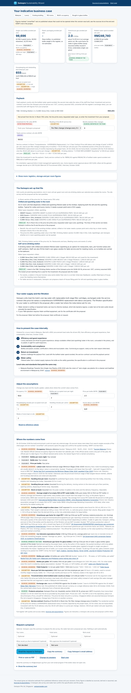

# Swisspro Sustainability Wizard

A multiple-choice web tool for hotels in Malaysia, Indonesia and the Philippines (Singapore selectable)
that shows what replacing bottled water with Swisspro filtered drinking water means for them: bottles and
plastic avoided, money and housekeeping time saved, the payback (cash only and with the value of staff
time), and the Swisspro set-up that fits their rooms and outlets. Version 2 is a decision-support tool for
the hotel, not a sales questionnaire: six short steps, every question changes the result.

Built for Swisspro Pte Ltd by the student project team. Static HTML/CSS/JS, no build step, no backend.
See CHANGELOG.md for what changed against version 1 and VERIFY.md for the status of every source.


## Try it
- **Hosted:** enable GitHub Pages on this repository (Settings -> Pages -> Deploy from a branch -> this
  branch, folder `/`). The wizard is then at `https://<owner>.github.io/Sustainability-Wizard/`.
- **Locally:** any static server works, e.g. `python3 -m http.server 8080` in this folder, then open
  http://localhost:8080/ . Opening `index.html` directly from disk also works (classic scripts, no modules).

## What the user sees
1. Six short steps: market; rooms, tier, building, occupancy; water in rooms today (bottles, size, price);
   areas; in-room placement and water type; water supply and Halal. Every numeric question has "not sure"
   backed by a market reference value; only the room count is typed.
2. A result page with five tiles, each labelled with the provenance of its inputs (sourced, unverified /
   derived / assumption / your input), the payback with the service contract from the price list (interval
   and currency as visible assumptions), logistics behind "show more", the solution per price-list area
   (In-Room, F&B / Drinking Station), the water-supply notes, the argument order for the internal case with
   a neutral note on approval thresholds, an "adjust the assumptions" panel, the sources used, and an
   optional "request a proposal" form (timing and approval are optional fields there).
3. A sources page (`sources.html`) with the choice rules and the whole register, quotes, links and status.



## Design decisions
- **Only result-changing questions.** Ownership, approval, timing, drivers and the lead score of version 1
  are gone; timing and approval survive as optional fields of the proposal form.
- **ROI first, sustainability last** in the presentation order (Marriott interview); guest experience first
  for luxury; efficiency and water safety first where bottled water is cheap (below US$0.25 per bottle,
  a labelled provisional rule).
- **No invented numbers.** `js/factors.js` is the single register; every value carries a `kind` and, for
  sourced values, a verification `status`. Because the build environment could not open any page, all
  sourced values are "unverified" and listed in VERIFY.md with URL and quoted wording. One choice rule per
  disputed factor is stated once.
- **Products only from the price list.** `js/pricelist.js` holds the Hospitality section verbatim (In-Room
  vs F&B / Drinking Station, PDF dated 16 Sep 2026, prices excl. GST). Lines are matched on the printed
  water types; the cheapest match sets the investment. The 85.00 servicing line has three readings with the
  most conservative (per change every 9 months) as default; currency SGD is a labelled assumption.
- **No unverified product claims**: filtration is described generically and confirmed in the proposal.
- **Conservative defaults**: lightest documented bottle weight, cheapest reference bottle price, statutory
  floor wages, cradle-to-gate emissions only.

## Project structure
```
index.html            wizard page
sources.html          factor registry rendered as a page
styles.css            styles (brand tokens at the top)
js/factors.js         ALL numbers with provenance and verification status; choice rules; market values
js/engine.js          pure calculation functions (unit-tested)
js/model.js           answers -> engine inputs, applying labelled defaults
js/recommend.js       solution per price-list area, filtration notes, argument order, approval note
js/pricelist.js       Hospitality price list (to transcribe), servicing line, interval and currency assumptions
js/questions.js       the six steps and the optional proposal fields
js/app.js             UI rendering, local storage, proposal summary
test/*.test.js        node --test unit tests (34)
tools/walkthrough.js  headless Chromium end-to-end run with screenshots (three market scenarios)
tools/build-artifact.js single-file build for hosted previews
VERIFY.md             every factor with value, URL, quote and whether the page was opened
CHANGELOG.md          changes against version 1
docs/                 methodology, research notes, demo script, pricing how-to, open items, screenshots
```

## Maintaining the numbers
- Change a factor: edit its `value` in `js/factors.js` and update `source`/`note`. Never hard-code numbers
  in `js/app.js`.
- Load the price list: see `docs/PRICING-HOWTO.md` (the only source for products and prices).
- Verify a source: open the URL, confirm the quote, set `status: 'opened'` (VERIFY.md).
- Add a market: add a country entry (currency, exchange rate, occupancy, wage, bottle prices, context).
- Add or reword a question: `js/questions.js`; the option `id`s are what `js/model.js` and
  `js/recommend.js` read.

## Tests
```bash
npm test
```
runs the unit tests. `node tools/walkthrough.js` (Playwright + Chromium) drives the whole wizard for
three market scenarios on desktop and mobile, fails on console errors or forbidden texts and refreshes
`docs/screenshots/` (`WALK_ONLY=<scenario> WALK_VIEW=desktop WALK_DEBUG=1` narrow and trace a run).
GitHub Actions runs the unit tests on every push.

## Status
See `docs/OPEN-ITEMS.md`. The main gaps are the verification of every web source (no page could be opened
from the build environment), the PDF of the price list in the repository, and Swisspro's confirmation of
the service-line reading and the lead email address.
