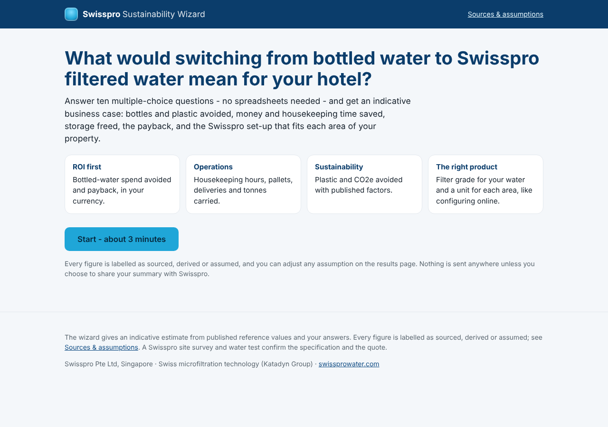
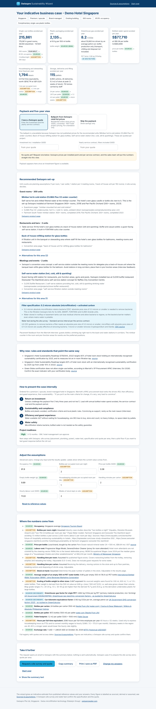

# Swisspro Sustainability Wizard

A multiple-choice web tool for hotels in Singapore, Malaysia, Indonesia and the Philippines that shows what
replacing bottled water with Swisspro filtered drinking water means for them: bottles and plastic avoided,
money and housekeeping time saved, storage and deliveries freed, the payback, the filter specification for
their water, and the Swisspro unit that fits each area. It also sorts the lead for Swisspro's sales team
(segment, areas, products, readiness, which argument to lead with).

Built for Swisspro Pte Ltd by the student project team. Static HTML/CSS/JS, no build step, no backend.



## Try it
- **Hosted:** enable GitHub Pages on this repository (Settings -> Pages -> Deploy from a branch -> this
  branch, folder `/`). The wizard is then at `https://<owner>.github.io/Sustainability-Wizard/`.
- **Locally:** any static server works, e.g. `python3 -m http.server 8080` in this folder, then open
  http://localhost:8080/ . Opening `index.html` directly from disk also works (classic scripts, no modules).

## What the user sees
1. Ten short steps, every answer multiple choice (room count is the only number; occupancy, bottles per
   night and prices have "not sure" options backed by sourced reference values).
2. A results page with six headline tiles, each with the provenance of its inputs (sourced / derived /
   assumption / your input), a payback section (own quote, or a clearly labelled ballpark from Swisspro's
   published retail prices until the hotel price list is loaded), the recommended set-up per area with
   filter specification, the local rules and standards that support the change, the argument order for the
   internal business case, an "adjust the assumptions" panel, the list of sources, and actions: email the
   summary to Swisspro, copy it, print to PDF.
3. A sources page (`sources.html`) that renders the whole factor registry with quotes, links and dates.



## Design decisions
- **ROI first, sustainability last** in the presentation order, following Marriott's APAC procurement lead;
  the order changes for luxury hotels (guest experience first) and for Malaysia/Indonesia where bottled
  water is cheap (efficiency and water safety first).
- **No invented numbers.** `js/factors.js` is the single registry; every value carries a `kind`
  (`sourced`, `sourced-secondary`, `derived`, `assumption`, `constant`) with quote, URL and access date, or
  an explanatory note for assumptions. The UI shows the label next to every figure. The unit tests fail if a
  factor lacks provenance.
- **Conservative defaults**: lightest documented bottle weight, cheapest sourced bottle price, statutory
  floor wages, cradle-to-gate emissions only.
- **Lead sorting without friction**: contact details are optional; the summary text carries segment,
  recommended products and a readiness score for Swisspro.
- **Configurator feel** for the device choice (placement, temperatures, finish, space), as requested in the
  interview ("like IKEA, you specify and choose online").

## Project structure
```
index.html            wizard page
sources.html          factor registry rendered as a page
styles.css            styles (brand tokens at the top)
js/factors.js         ALL numbers with provenance; market reference values; trigger facts
js/engine.js          pure calculation functions (unit-tested)
js/model.js           answers -> engine inputs, applying labelled defaults
js/recommend.js       lead score, argument order, product fit, filter specification, unit plan
js/products.js        Swisspro product families as described on swissprowater.com
js/pricing.js         pricing config: hotel price list (to fill) and retail reference (labelled)
js/questions.js       the ten steps
js/app.js             UI rendering, local storage, summary/email
test/*.test.js        node --test unit tests (32)
tools/walkthrough.js  headless Chromium end-to-end run with screenshots
docs/                 methodology, research notes, demo script, pricing how-to, open items, screenshots
```

## Maintaining the numbers
- Change a factor: edit its `value` in `js/factors.js` and update `source`/`note`. Never hard-code numbers
  in `js/app.js`.
- Load the price list: see `docs/PRICING-HOWTO.md`.
- Add a market: add a country entry (currency, exchange rate, occupancy, wage, bottle prices, context).
- Add or reword a question: `js/questions.js`; the option `id`s are what `js/model.js` and
  `js/recommend.js` read.

## Tests
```bash
npm test
```
runs the unit tests. `node tools/walkthrough.js` (Playwright + Chromium) drives the whole wizard for
three scenarios on desktop and mobile, fails on console errors and refreshes `docs/screenshots/`.
GitHub Actions runs the unit tests on every push.

## Status
See `docs/OPEN-ITEMS.md`. The main gaps are the hotel price list (not available during the build), direct
verification of the cited pages (they were read through search excerpts because the build environment had
no outbound web access), Swisspro's certificates and brand assets.
